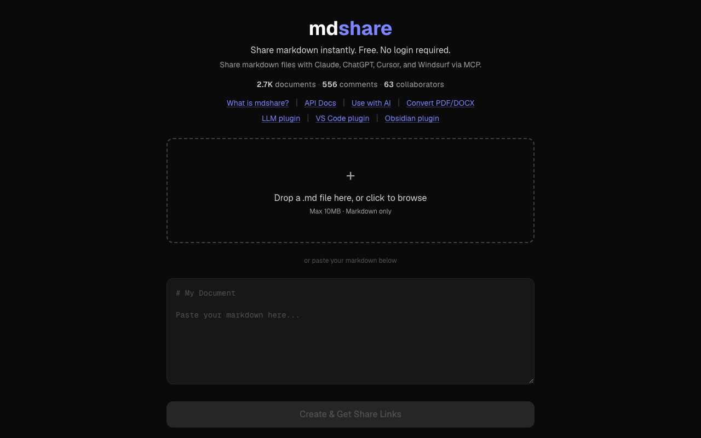
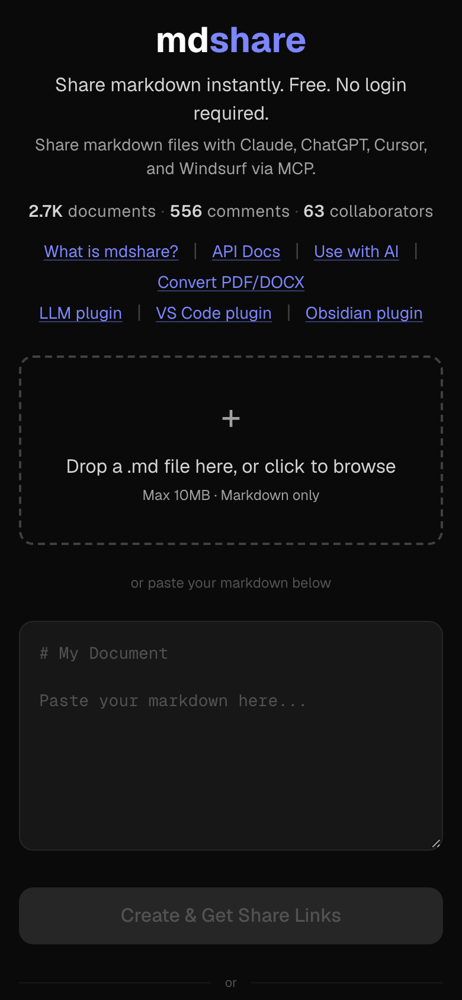
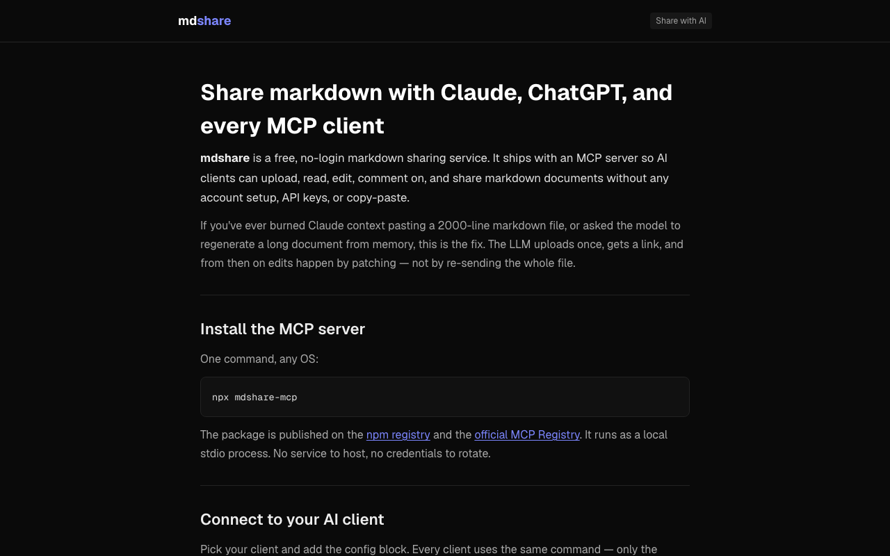

# mdshare

Free markdown sharing with no login: upload a file, get a link, and collaborate with comments, live edits and permission links.

[](LICENSE)
[](https://www.npmjs.com/package/mdshare-mcp)
[](https://registry.modelcontextprotocol.io/v0/servers?search=io.github.sathya-sankaran/mdshare)
[](https://github.com/urbanmorph/mdshare/actions/workflows/deploy.yml)
[](https://github.com/urbanmorph/mdshare)
[](https://mdshare.live)
[](https://marketplace.visualstudio.com/items?itemName=urbanmorph.mdshare-live)
[](https://community.obsidian.md/plugins/mdshare)

[](https://glama.ai/mcp/servers/urbanmorph/mdshare)
[](https://mcptry.com/servers/io.github.sathya-sankaran/mdshare)
[](https://mcpservers.org/servers/urbanmorph/mdshare)

**[mdshare.live](https://mdshare.live)** | **[API docs](https://mdshare.live/docs)** | **[Use with AI](https://mdshare.live/share-markdown-with-ai)** | **[Plugins](https://mdshare.live/install-mdshare-plugin)** | **[About](https://mdshare.live/about)**



## Contents

- [What it does](#what-it-does)
- [Features](#features)
- [Quick start](#quick-start)
- [MCP tools](#mcp-tools)
- [Plugins](#plugins)
- [API](#api)
- [Privacy and permissions](#privacy-and-permissions)
- [Architecture](#architecture)
- [Development](#development)
- [Deploy](#deploy)
- [Contributing](#contributing)
- [License](#license)

## What it does

mdshare turns markdown into a shareable link. Paste or drop a `.md` file at [mdshare.live](https://mdshare.live), send it with `curl`, or let an AI client upload it through the MCP server. Neither you nor the people you share with need an account.

Each document gets links at four permission levels (admin, edit, comment, view). People with an edit link change the document in a WYSIWYG editor, people with a comment link anchor comments to text, and everyone with the document open sees changes as they happen.

<p>
  
  &nbsp;
  
</p>

## Features

- **Four permission levels:** admin, edit, comment and view, each with its own link.
- **WYSIWYG editor:** formatting toolbar, tables, code blocks and keyboard shortcuts.
- **Inline comments:** anchor a comment to specific text, reply, and resolve.
- **Real-time sync:** changes broadcast over WebSocket with presence indicators; falls back to polling.
- **Link management:** revoke links instantly, set optional expiry, up to 50 links per document.
- **Version history:** see who edited and when.
- **Recent documents sync (optional):** an encrypted copy of your recent-documents list, so it follows you across devices. It is encrypted in your browser; the server cannot read it.
- **REST API and MCP server:** for scripts and for Claude, ChatGPT/Codex, Gemini CLI, Cursor and Windsurf.
- **Plugins:** Claude Code, Cursor, VS Code and Obsidian.

## Quick start

### Web

Open [mdshare.live](https://mdshare.live), paste markdown or drop a `.md` file (up to 10 MB), and select **Create & Get Share Links**.

### curl

```bash
curl -X POST https://mdshare.live/api/documents \
  -H "Content-Type: text/markdown" \
  --data-binary @your-file.md
```

The response contains the document ID, an admin URL and the expiry date. Keep the admin URL private: it gives full control. From it you can create edit, comment or view links to share.

Any converter that writes markdown to stdout can pipe straight in. See [Convert and share markdown](https://mdshare.live/convert-and-share-markdown) for recipes with markitdown, pandoc, Docling, Marker, Firecrawl and Jina Reader.

### MCP server

The MCP server is the npm package [`mdshare-mcp`](https://www.npmjs.com/package/mdshare-mcp). It runs locally over stdio and needs no API key or environment variables.

```bash
npx mdshare-mcp
```

Add it to your client's MCP config:

```json
{
  "mcpServers": {
    "mdshare": {
      "command": "npx",
      "args": ["mdshare-mcp"]
    }
  }
}
```

| Client | Config file |
|--------|-------------|
| Claude Desktop | `claude_desktop_config.json` |
| Claude Code | Use the [plugin](#claude-code) (no JSON to edit) |
| Cursor | `~/.cursor/mcp.json`, or **Add to Cursor** on the [Cursor Directory listing](https://cursor.directory/plugins/mdshare) |
| Windsurf | `~/.codeium/windsurf/mcp_config.json` |
| OpenAI Codex CLI | `~/.codex/config.json` |
| Gemini CLI | `~/.gemini/settings.json` |

Then ask, for example, *"upload my-notes.md to mdshare and give me a share link"*. The server reads files from disk by path, so large documents do not pass through the conversation. Full setup: [mdshare.live/share-markdown-with-ai](https://mdshare.live/share-markdown-with-ai). Package docs: [mcp/README.md](mcp/README.md).

No MCP client? Point any chatbot that can fetch URLs at the API:

```text
Read https://mdshare.live/docs/raw to learn the mdshare API,
then upload this markdown and give me a share link.
```

## MCP tools

From [`mcp/index.js`](mcp/index.js) (v1.5.0):

| Tool | What it does |
|------|--------------|
| `upload_markdown` | Upload markdown by `file_path` (preferred) or inline `content`; returns a share link (default permission: comment). |
| `read_document` | Read a document; optionally save it to `output_path` on disk. |
| `update_document` | Replace the content. Optional `base_hash` refuses to overwrite newer edits. |
| `patch_document` | Apply find/replace operations without resending the whole document. Optional `base_hash`. |
| `generate_link` | Create a view, edit or comment link. |
| `list_links` | List a document's share links and their status. |
| `revoke_link` | Revoke a share link permanently. |
| `set_expiry` | Change when the document auto-deletes (a future date, at most one year out). |
| `list_comments` | List comments, replies and resolution status. |
| `post_comment` | Add a comment, optionally anchored to text. |
| `resolve_comment` | Resolve or reopen a comment. |
| `get_versions` | Show edit history (who and when). |
| `list_my_documents` | List documents uploaded through this server on this machine. |
| `get_admin_url` | Return the admin URL of a stored document, only when the user asks for it. |
| `register_document` | Add a previously saved admin URL to the local store. |

Admin credentials for documents uploaded through the server are kept in `~/.mdshare-mcp/documents.json` (mode 0600), so `upload_markdown` returns only the share link and later calls need just the document ID.

Listed in the [official MCP Registry](https://registry.modelcontextprotocol.io/v0/servers?search=io.github.sathya-sankaran/mdshare) as `io.github.sathya-sankaran/mdshare`, on [Glama](https://glama.ai/mcp/servers/urbanmorph/mdshare), and in [awesome-mcp-servers](https://github.com/punkpeye/awesome-mcp-servers).

## Plugins

### Claude Code

```text
/plugin marketplace add urbanmorph/mdshare
/plugin install mdshare@urbanmorph
```

Wraps the MCP server with one skill, `mdshare-tools`, that Claude uses on requests like *"share this markdown"*. [Setup guide](https://mdshare.live/install-mdshare-plugin) | [source](plugins/claude-code/)

### Cursor

Listed on [Cursor Directory](https://cursor.directory/plugins/mdshare): select **Add to Cursor** on the listing. Same MCP server and skill as the Claude Code plugin. [Source](plugins/mdshare-cursor/)

### VS Code

Search for **mdshare** in the Extensions panel, or install from the [Marketplace page](https://marketplace.visualstudio.com/items?itemName=urbanmorph.mdshare-live). Right-click a `.md` file and choose **Share on mdshare**, or share a selection. Also works in Cursor and Windsurf. [Guide](https://mdshare.live/docs#vscode) | [source](https://github.com/urbanmorph/mdshare-vscode)

### Obsidian

Listed in the [Obsidian Community Plugins directory](https://community.obsidian.md/plugins/mdshare): **Settings > Community Plugins > Browse**, search for "mdshare". Right-click a file to share it; the admin URL is copied to your clipboard. [Guide](https://mdshare.live/docs#obsidian) | [source](https://github.com/urbanmorph/obsidian-mdshare)

## API

Base URL: `https://mdshare.live`. Full reference at [mdshare.live/docs](https://mdshare.live/docs) (plain text for LLMs at [/docs/raw](https://mdshare.live/docs/raw)).

| Action | Request |
|--------|---------|
| Upload | `POST /api/documents` (`Content-Type: text/markdown`, raw markdown body) |
| Read | `GET /api/d/{id}?key={key}` (`Accept: text/markdown` for raw) |
| Update | `PUT /api/d/{id}?key={edit_key}` (optional `X-Base-Hash`; 409 if the document changed) |
| Patch | `PATCH /api/d/{id}?key={edit_key}` (JSON `{operations: [{find, replace, replace_all?}]}`) |
| Links | `POST /api/d/{id}/links?key={admin_key}` (`{permission, label, expires_at}`) |
| Comments | `POST /api/d/{id}/comments?key={key}` |
| Versions | `GET /api/d/{id}/versions?key={key}` |

Limits: 10 MB per document; 10 creates per minute and 50 per day per IP; 30 updates per minute; 20 comments per minute; 50 links per document. A 429 includes `Retry-After`; an expired document returns 410.

## Privacy and permissions

- **No accounts.** The link is the only access control. Anyone with a link has that link's permission, so do not share sensitive content.
- **Permission levels:** `adm_` full control, `edt_` read and write, `cmt_` read and comment, `viw_` read only. Each link can be revoked or given its own expiry.
- **Tokens are hashed.** Requests are checked against a SHA-256 hash of the token. The stored copy of each share token (kept so admins can list links) is encrypted with AES-GCM under a Worker secret.
- **Content is sanitized** on the server before it is stored.
- **Documents expire** 90 days after creation by default. The admin can move the expiry to any future date up to a year out. A daily job deletes expired documents with their comments, versions and links.
- **What is collected:** document content, comments with the display name the commenter chooses, transient IP and user-agent logs at Cloudflare for abuse detection, and aggregate page-view counts through Cloudflare Web Analytics (no cookies). No email addresses, trackers or profiles.

Full policy, including GDPR and DPDPA rights: [mdshare.live/privacy](https://mdshare.live/privacy).

## Architecture

| Component | Technology |
|-----------|------------|
| Framework | Astro 5 (static pages pre-rendered, API routes on the Worker) |
| UI | React 19 as Astro islands |
| Hosting | Cloudflare Workers |
| Database | Cloudflare D1 (SQLite) |
| Real-time | Cloudflare Durable Objects (WebSocket) |
| Editor | Tiptap with tiptap-markdown |
| Styling | Tailwind CSS v4 |
| CI/CD | GitHub Actions |

Layout:

```text
src/pages/        Astro pages; src/pages/api/ holds the REST API
src/worker.ts     Worker entry: WebSocket routing, security headers, daily cleanup cron
worker/           DocumentWebSocket Durable Object
lib/              sanitization, tokens, permissions, D1 access, rate limits
components/       Tiptap editor, toolbar, comments, link manager
migrations/       D1 schema migrations
mcp/              mdshare-mcp npm package
plugins/          Claude Code and Cursor plugins
```

## Development

Requires Node.js 22 (the version CI uses).

```bash
git clone https://github.com/urbanmorph/mdshare.git
cd mdshare
npm install

# Create the local D1 database schema
npm run db:migrate:local

# Build and serve on http://localhost:3737
npm run dev
```

Optional: put `TOKEN_ENC_KEY` (a base64-encoded AES key, for example from `openssl rand -base64 32`) in `.dev.vars` to encrypt stored share tokens locally. Without it, tokens are stored unencrypted and a warning is logged.

| Command | What it does |
|---------|--------------|
| `npm run dev` | `astro build`, then `wrangler dev` on port 3737 |
| `npm run build` | Build the site into `dist/` |
| `npm test` | Run the unit tests (`node --test`) |
| `npm run lint` | Run ESLint |
| `npm run cf-typegen` | Regenerate `cloudflare-env.d.ts` from the Wrangler config |

## Deploy

Every push to `main` runs [`.github/workflows/deploy.yml`](.github/workflows/deploy.yml): `npm ci`, `astro build`, apply D1 migrations to the remote database, then `wrangler deploy`. It needs the repository secrets `CLOUDFLARE_API_TOKEN` and `CLOUDFLARE_ACCOUNT_ID`. Set `TOKEN_ENC_KEY` as a Worker secret (`npx wrangler secret put TOKEN_ENC_KEY`) to encrypt stored share tokens.

To deploy by hand with your own Cloudflare account, create a D1 database, set its ID in [`wrangler.jsonc`](wrangler.jsonc), then:

```bash
npm run db:migrate   # apply migrations to the remote D1 database
npm run deploy       # astro build && wrangler deploy
```

## Contributing

Issues and pull requests are welcome. Please open an issue first to discuss significant changes. mdshare is deliberately minimal: a feature should make upload, share and collaborate faster or clearer without adding UI clutter (see [CLAUDE.md](CLAUDE.md) for the design principles).

Before opening a PR, run `npm test` and `npm run lint`.

## License

[MIT](LICENSE) © 2026 UrbanMorph
